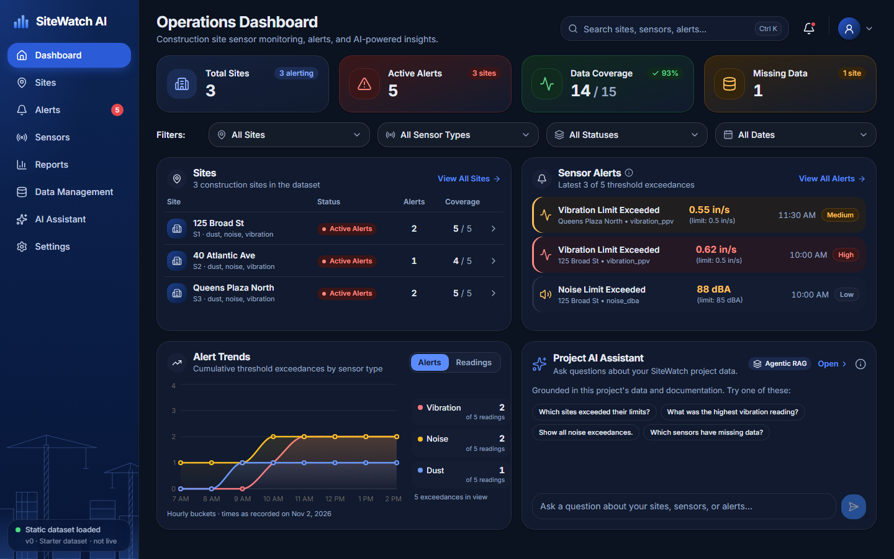

# SiteWatch AI

Construction-site monitoring dashboard for EnTech's New York City sites. Engineers and project managers can see which sites exceeded their configured **vibration**, **noise** and **dust** limits, when it happened and by how much. They can also generate a client-ready summary and ask **SiteWatch AI**, a project-only assistant, about the data.

- **Backend:** Python, FastAPI and Pydantic. It reads `readings.csv` and `thresholds.json`, validates every row, and classifies each reading as `NORMAL`, `EXCEEDED` or `MISSING_DATA`.
- **Frontend:** Next.js (App Router), React, TypeScript, Tailwind CSS, shadcn/ui, Lucide icons and Recharts, with light and dark mode.
- **AI:** Claude (Anthropic API) or a Groq-hosted model such as `openai/gpt-oss-120b`, selected with `AI_PROVIDER`, using read-only tools over the same validated data as the dashboard, plus local documentation retrieval.

The data comes from static files: the committed starter dataset or an uploaded, versioned dataset. It is not a live or real-time feed.



More screenshots: [1440×900 light](design/screenshots/dashboard-1440-light.png), [1920×1080 dark](design/screenshots/dashboard-1920-dark.png). Launch video: [brag-output/brag.mp4](brag-output/brag.mp4) (21 s, built from real captures of the app).

## Features

- **Dashboard** (compact layout from [design/sitewatch-compact-dashboard.png](design/sitewatch-compact-dashboard.png)): the whole Operations Dashboard fits one 1440×900 or 1920×1080 screen at 100% zoom, with no horizontal scrolling.
  - KPI cards (92px): Total Sites, Active Alerts, Data Coverage and Missing Data.
  - Four equal filters (site, sensor type, status, date). Every count and card follows them.
  - A balanced two-column grid: Sites (compact rows, no sideways scrolling) | Sensor Alerts, then Alert Trends | a compact Project AI Assistant preview that shows the latest exchange and links to the full assistant.
  - Tablets stack the cards; phones get a single column with no page-wide overflow. Playwright checks the fit at 1440×900 and 1920×1080.
- **Sites:** status, alert counts and data coverage per site. Each site's page groups its readings by sensor, with timestamps, units, configured limits and exceedance amounts.
- **Alerts:** confirmed exceedances only, with measured value, limit, excess and percentage over. Missing data is kept separate.
- **Sensors:** all readings, searchable and paginated, filterable by site, sensor, status and time range, with sortable timestamp and value columns. Missing values show as "Missing", never zero. The old `/readings` URL redirects here.
- **Reports:** a deterministic plain-English client report for all sites or one site, with Copy and Download (.txt), a professional PDF summary and an exceedances CSV.
- **Data Management:** administrators upload, validate, preview and activate new `readings.csv` / `thresholds.json` files. Every import is an immutable version that can be rolled back. See [Data management](#data-management-uploads).
- **Charts:** readings over time per site with the configured limit and exceedance markers, a site comparison relative to each limit, date range filters, and a dataset comparison across versions. Missing readings are gaps, never zeros.
- **AI Assistant:**
  - A floating panel, a dedicated page and the dashboard card.
  - Answers cite their sources (data files or documentation sections).
  - Unrelated questions are refused.
- **Settings:** theme, API connection, data source, AI status and configured thresholds.
- **Header:** per-page title, Ctrl/⌘+K search across readings, a notifications menu listing the real exceedances, and a workspace menu (theme, reload, settings, API docs). There are no user accounts; dataset management has its own administrator sign-in.
- **Layout:** responsive, with an expanded sidebar on desktop, an icon rail on tablet and an off-canvas menu on phones. Light theme by default; dark mode is in the workspace menu.

### Where the dashboard differs from the reference image, and why

The reference image contains some sample figures the supplied data cannot support. They were replaced with measured values instead of being invented:

| Reference shows | SiteWatch shows | Reason |
|---|---|---|
| "Sensors Online 28 / 30" | **Data Coverage**: readings with a value / readings received (14 / 15, 93%) | The CSV has no sensor connectivity data. |
| "+67% vs. last 7 days" style badges | Counts in the current view (e.g. "3 sites", "1 site") | The data covers one day, so there is no week-over-week change. |
| Seven daily points on Alert Trends | Hourly buckets (daily when the data spans more than two days) | No seven-day history exists in the data. |
| Borough names, site photos, sensor IDs such as "Vib-03" | Site ID, sensor types, and sensor names from the CSV | Not in the data. |
| A user photo | A workspace menu that states no sign-in is configured | There is no authentication in this demo. |
| "Real-time" wording | "Static dataset loaded" | The data is loaded from files, not a live feed. |

**Alert severity** (High / Medium / Low) is a display priority based on how far a reading was above its limit: High at 20% or more, Medium from 5% to under 20%, Low under 5%. It is not a regulatory classification. See [docs/methodology.md](docs/methodology.md).

## Repository layout

```
backend/            FastAPI service
  app/              config, schemas, errors, services/, ai/, api/routes.py
  data/             readings.csv, thresholds.json (the source data)
  tests/            pytest suite
  scripts/          bundle_docs.py (Vercel build step)
frontend/           Next.js dashboard
  src/app/          one route per sidebar section
  src/components/   layout, widgets, tables, charts, chat
  e2e/              Playwright end-to-end tests
docs/               methodology.md, architecture.md (also indexed by the assistant)
design/             sitewatch-reference.png (dashboard design reference)
vercel.json         Vercel Services: Next.js + FastAPI under one URL
```

## Deploy to Vercel (one URL)

The root [vercel.json](vercel.json) uses [Vercel Services](https://vercel.com/docs/services) to deploy both apps in one project:

| Path | Service |
| --- | --- |
| `/api/*`, `/health`, `/docs`, `/redoc`, `/openapi.json` | `api`: FastAPI (`backend/`, entrypoint `app.main:app`) |
| everything else | `web`: Next.js (`frontend/`) |

Vercel passes the original path to the service, so the backend's routes are unchanged. The frontend calls `/api/...` on its own origin, so no CORS setup is needed.

1. Import the GitHub repository in Vercel. Leave the Root Directory as the repository root; Vercel detects both services from `vercel.json`.
2. In **Project Settings > Environment Variables**, add `AI_PROVIDER` and the matching key: `groq` + `GROQ_API_KEY`, or `anthropic` + `ANTHROPIC_API_KEY` (server-side only). For uploads, also add `DATABASE_URL` (PostgreSQL) and `ADMIN_TOKEN`; see [Data management](#data-management-uploads). The optional settings are listed in [.env.example](.env.example). Do **not** set `NEXT_PUBLIC_API_BASE_URL`: leaving it unset makes the browser call the API on the same origin.
3. Deploy, then check `https://<your-app>.vercel.app/health` and `/docs`.

How the details are handled:
- `backend/data/readings.csv` and `thresholds.json` are committed and found through paths relative to the code, so they are bundled with the Python function.
- The function bundle contains only `backend/`, so the backend build step (`scripts/bundle_docs.py`) copies `README.md` and `docs/*.md` into `backend/project_docs/` for the assistant's doc search.
- The Python version is pinned in `backend/.python-version` (3.12) and dependencies come from `backend/requirements.txt`. The function's `maxDuration` is 300 s, which covers the assistant's 90 s deadline plus one slow model call with a retry.
- `ENVIRONMENT` falls back to Vercel's `VERCEL_ENV` (production / preview).
- Database migrations in `backend/migrations/` are bundled with the function and applied automatically.

## Data management (uploads)

Administrators can upload new `readings.csv` and `thresholds.json` files on the **Data Management** page (`/data`), check them, preview the effect and activate them. Every page, export and the AI assistant then use the new dataset.

1. **Select files.** Drag and drop or pick `readings.csv`, `thresholds.json`, or both. If you upload one file, the other is reused from the active dataset. Example templates can be downloaded on the page.
2. **Preview changes.** The server validates both files and shows blocking errors and warnings separately, with CSV row numbers. It then shows totals, valid, normal, exceeded and missing readings, sites, sensor categories, a comparison with the active dataset and the first 25 classified rows. **Nothing is saved and the active dataset does not change.**
3. **Activate dataset.** The server validates the files again, stores them as a new immutable version and switches the active version in the same database transaction. If anything fails, nothing changes.
4. **Roll back.** The Dataset history lists every version with its statistics and stored validation report. Activate any older version, including the original starter dataset (v0), to roll back.

### File formats and validation

`readings.csv` needs the columns `site_id, site_name, sensor, timestamp, value` (extra columns are ignored with a warning). `thresholds.json` is an object keyed by sensor id or type: `{"noise_dba": {"limit": 85, "unit": "dBA"}}`.

| Blocking errors (nothing can be activated) | Warnings (shown, not blocking) |
| --- | --- |
| Wrong file type, not UTF-8 text, empty, larger than the limit, more than 50,000 rows | Blank `value`: stored as MISSING_DATA (null, never zero) |
| Missing or duplicate columns; rows with too many fields | Extra, unused columns |
| Blank `site_id`, `site_name`, `sensor` or `timestamp` | Exact duplicate rows (the repeat is ignored) |
| Invalid site ID (letters, digits, `-`, `_`; no spaces) | A threshold with no matching readings |
| Invalid sensor name, or a sensor with no matching threshold | A unit unusual for its sensor type, a limit of 0, extra threshold fields |
| Timestamp that is not ISO 8601 | |
| Value that is not a number, NaN/infinity, or negative | |
| Same site, sensor and timestamp with different values | |
| One `site_id` used with different site names | |
| Invalid JSON, duplicate sensor keys, a missing/non-numeric/negative `limit`, or a missing `unit` | |

Limits: `readings.csv` up to 4 MB and 50,000 rows, `thresholds.json` up to 64 KB, and request bodies up to 4.5 MB (Vercel's own limit).

### Administrator access

Uploading, previewing and activating require an administrator. Set `ADMIN_TOKEN` (at least 16 random characters, e.g. `python -c "import secrets; print(secrets.token_urlsafe(32))"`) in the backend environment. Without it, these features are disabled.

- Signing in sends the token to the API once. The API returns a signed, expiring (8 h) session cookie: `HttpOnly`, `SameSite=Strict`, `Secure` on HTTPS, and scoped to `/api`. The token is never stored in the browser.
- Writes made with the cookie must also send the `X-SiteWatch-Admin` header (CSRF protection). Scripts can use `Authorization: Bearer <ADMIN_TOKEN>` instead.
- Failed sign-ins are throttled.
- **Limitations (demo-grade):** one shared token, with no individual accounts, roles or audit of who signed in (versions record "admin"). Throttling is per function instance. A session can only be revoked early by rotating `ADMIN_TOKEN`, which signs everyone out. For production, put the page behind your identity provider.
- Reading the dataset list and the active dataset is public, like the rest of the dashboard.

### Storage and database setup

Uploaded datasets are stored in **PostgreSQL**, set with `DATABASE_URL` (`postgres://` or `postgresql://`; `sslmode=require` is supported). Vercel Functions have no durable filesystem, so uploads are never written to the deployed source directory or to temporary files.

- **Tables** (created automatically from [backend/migrations/postgres](backend/migrations/postgres) on first use, tracked in `schema_migrations`):
  - `dataset_versions`: metadata, stats, the validation report and the source files.
  - `dataset_readings` and `dataset_thresholds`: the parsed data.
  - `active_dataset`: the single active pointer.
  - `dataset_activations`: the activation history.
- **Immutable versions:** version rows cannot be updated or deleted (database triggers reject it).
- **No stale data:** every request reads the active pointer from the database, and classified versions are cached by their immutable id. Function instances therefore never serve an outdated selection.
- **To connect a database:** create a PostgreSQL database with any provider (Vercel Marketplace → Neon or Supabase, or your own server). Add its connection string as `DATABASE_URL` in Vercel → Project Settings → Environment Variables, then redeploy. `POSTGRES_URL` is also accepted. The tables are created on the first request.
- **Without `DATABASE_URL` on Vercel:** the dashboard serves the committed starter dataset (read-only). The Data Management page explains that activation is disabled. Previews still work, and nothing is claimed to be saved.
- **Local development:** without `DATABASE_URL`, uploads go to a SQLite file at `backend/.local/sitewatch.sqlite3` (git-ignored; set `SQLITE_PATH` to move it). SQLite is never used on Vercel.
- The original `backend/data/readings.csv` and `thresholds.json` stay in the repository as the read-only **starter dataset (v0)**.

### Reports and exports

All downloads are built from the active dataset version and name it:

- `GET /api/exports/readings.csv`: readings with the same filters as `/api/readings`. Available as **Export CSV** on Sensors.
- `GET /api/exports/exceedances.csv`: exceedances. Available on Alerts and Reports.
- `GET /api/reports/summary.pdf?site_id=&start=&end=`: a printable summary with the dataset version, analyzed period, sites, sensors and limits, exceedances, missing-data warnings and the client report. Available as **Download PDF** on Reports.

CSV text cells that start with `=`, `+`, `-`, `@`, a tab or a carriage return get a leading apostrophe, so a spreadsheet never runs them as formulas.


## Local setup on Windows

Prerequisites: **Python 3.12+**, **Node.js 20.9+** (Node 24 LTS recommended) and Git. Run the commands below in PowerShell or the VS Code terminal.

### 1. Install backend dependencies

```powershell
cd backend
python -m pip install -r requirements-dev.txt
```

### 2. Install frontend dependencies

```powershell
cd ..\frontend
npm install
copy .env.example .env.local
```

`frontend/.env.local` sets `NEXT_PUBLIC_API_BASE_URL=http://localhost:8001`.

### 3. Run FastAPI (terminal 1)

```powershell
cd backend
python -m uvicorn app.main:app --reload --port 8001
```

- API: http://localhost:8001
- Interactive API docs: http://localhost:8001/docs
- Health: http://localhost:8001/health

Port 8001 is used because 8000 is often taken by other local services. If you choose another port, update `NEXT_PUBLIC_API_BASE_URL` to match.

### 4. Run Next.js (terminal 2)

```powershell
cd frontend
npm run dev
```

### 5. Open the dashboard

Go to http://localhost:3100.

### 6. Enable and test the AI chat (optional)

The dashboard works fully without an AI key. To enable SiteWatch AI:

1. Create an API key in the Anthropic Console (https://platform.claude.com/, API keys), or a Groq key (https://console.groq.com/keys).
2. Copy `backend\.env.example` to `backend\.env`.
3. Set `ANTHROPIC_API_KEY=` to your key in `backend\.env` (for Groq: `AI_PROVIDER=groq` and `GROQ_API_KEY=`). Do not paste it anywhere else; `.env` is git-ignored.
4. Restart the backend, then open http://localhost:3100/assistant and try a suggested prompt such as "Which sites exceeded their limits?".

Without a key, the assistant shows these setup steps and `POST /api/chat` returns HTTP 503 with code `AI_NOT_CONFIGURED`. It never returns a made-up answer.

## Tests and checks

```powershell
# Backend: unit and API tests (warnings are treated as errors)
cd backend
python -m pytest

# Frontend: lint, type check and production build
cd ..\frontend
npm run lint
npm run typecheck
npm run build

# End to end: starts its own backend (port 8011) and production frontend (port 3011)
npx playwright install chromium   # first time only
npm run test:e2e
```

Storage tests run on SQLite by default. To also run them against PostgreSQL, point `TEST_DATABASE_URL` at a disposable database whose name contains `test` (its tables are dropped): `$env:TEST_DATABASE_URL="postgresql://postgres@127.0.0.1:5432/sitewatch_test?sslmode=disable"; python -m pytest tests/test_dataset_store.py`.

The pytest suite covers threshold comparisons (including values exactly at the limit), missing-data handling, validation of every field, filtering, sorting, pagination, response schemas, CORS, error codes, and the assistant's scope guard, tool allowlist, argument validation, iteration limits and prompt-injection handling. A scripted fake model is used, so no real API calls are made.

The Playwright suite (20 tests) checks that the dashboard numbers match the CSV-derived values: 3 sites, 5 exceedances, 14 of 15 readings with data, and 1 missing. It also covers:

- every dashboard filter
- the hourly trend chart
- site drill-down and notifications
- Ctrl+K search and the `/readings` redirect
- every sidebar page
- alerts, and report copy and download
- dark mode
- the offline error state
- the AI setup message and a mocked grounded chat answer
- zero horizontal overflow on every page at phone width, and the tablet icon rail
- data management: admin-only access, row-numbered validation errors, preview without activation, activation updating every page and the PDF export, and rollback to the starter dataset

The backend suite also covers upload validation (every rule above), versioned storage (immutability, atomic failure, two independent instances), admin sessions and CSRF, every dataset endpoint, dashboard synchronization after activation, the assistant reading the active upload through read-only tools, and CSV/PDF exports including formula injection.

## Monitoring methodology

- Thresholds are looked up per sensor from `thresholds.json`: an exact sensor id first (`noise_dba`), then the sensor type (`noise`). Nothing is hardcoded. A rule without a numeric limit is reported as a warning and never treated as 0.
- A reading is **EXCEEDED** only when `value > limit` (strictly greater). A value equal to the limit is **NORMAL**.
- A reading is **MISSING_DATA** when its value is blank or invalid, its timestamp, site ID or sensor name is invalid, or no threshold is configured. Missing values stay null and are never treated as zero.
- Exceeding a configured monitoring threshold does not by itself mean a regulatory violation.

See [docs/methodology.md](docs/methodology.md) for details.

## API

| Method | Path | Purpose |
|---|---|---|
| GET | `/health` | Liveness, loaded data counts, AI configured flag |
| GET | `/api/overview` | Totals, site statuses, sensor breakdown, trends, recent alerts, validation warnings. Accepts the same filters as `/api/readings`: `site_id`, `sensor`, `status`, `start`, `end` |
| GET | `/api/sites` | Site summaries with status and alert counts |
| GET | `/api/sites/{site_id}` | One site with readings grouped by sensor |
| GET | `/api/readings` | Filters: `site_id`, `sensor` (id or type), `status`, `start`, `end`, `q`. Sorting: `sort` (`timestamp`, `value`, `site`, `sensor`) and `order`. Pagination: `page`, `page_size` (max 100) |
| GET | `/api/exceedances` | Confirmed exceedances with `severity`. Filters: `site_id`, `sensor`, `start`, `end`, `order` |
| GET | `/api/summary` | Deterministic client report, optional `site_id` |
| GET | `/api/sensors`, `/api/thresholds` | Sensors present and configured rules |
| GET | `/api/exports/readings.csv`, `/api/exports/exceedances.csv` | CSV downloads of the active dataset (same filters as above) |
| GET | `/api/reports/summary.pdf` | PDF monitoring summary; optional `site_id`, `start`, `end` |
| GET | `/api/datasets` | Dataset history (newest first, starter last) and storage status |
| GET | `/api/datasets/active` | The active dataset version with statistics |
| POST | `/api/datasets/preview` | **Admin.** Multipart `readings` and/or `thresholds`: validate, evaluate and compare without saving |
| POST | `/api/datasets` | **Admin.** Validate, store an immutable version and activate it (`activate=false` to only store) |
| POST | `/api/datasets/{id}/activate` | **Admin.** Activate a stored version or `starter` (rollback) |
| GET | `/api/datasets/{id}/validation` | **Admin.** The validation report recorded at upload |
| GET, POST, DELETE | `/api/admin/session` | Admin session status, sign in (`{"token": "..."}`), sign out |
| GET | `/api/chat/status` | Whether the assistant is configured |
| POST | `/api/chat` | Ask SiteWatch AI. Body: `{"messages": [{"role": "user", "content": "..."}]}` |

Every error has the same shape: `{"error": {"code": "SITE_NOT_FOUND", "message": "...", "details": {...}}}`.

## SiteWatch AI assistant

- **Scope:** sites, readings, thresholds, exceedances, missing data, comparisons and time ranges, client summaries, and this application's architecture, features, API and methodology. Unrelated questions get a brief refusal.
- **Tools (read-only allowlist):** `get_sites`, `get_site_details`, `get_readings`, `get_exceedances`, `get_thresholds`, `get_monitoring_summary`, `get_dataset_info`, `compare_dataset_versions`, `search_project_docs`. They call the same validated service functions as the API, so the model never computes authoritative totals from memory.
- **Active dataset:** every tool reads the dataset version active for that request, so answers follow uploads and rollbacks immediately. Sources name the version, e.g. `week46.csv (dataset v1)`. "What changed?" questions use `compare_dataset_versions`. The tools get a read-only catalog and cannot upload, store or activate data.
- **Retrieval:** `README.md` and `docs/*.md` are split by heading and ranked with BM25 keyword scoring, so no vector database is needed. Sources are returned as, for example, `README.md › Monitoring methodology`.
- **Safety:**
  - The key stays server-side.
  - Tool arguments are validated with strict Pydantic models.
  - Unknown tools are rejected.
  - Each turn is limited to 5 model steps, 6 tool calls per step, 12,000 characters per tool output, a time limit and a 6,000-character answer.
  - Instruction-like lines in retrieved documents are removed, and the model is told to ignore instructions inside tool results.
  - There are no tools that write files, run commands or reach other systems.
- **Configuration (`backend/.env`):** `AI_PROVIDER` (`anthropic` or `groq`), `ANTHROPIC_API_KEY` or `GROQ_API_KEY`, `AI_MODEL` (default `claude-opus-5-5`, or `openai/gpt-oss-120b` for Groq), `AI_EFFORT`, `AI_TIMEOUT_SECONDS`, `AI_MAX_TOOL_ITERATIONS`. Providers sit behind a small interface (`app/ai/provider.py`): Anthropic uses the `anthropic` SDK and Groq uses the official `groq` SDK.
- **Groq rate limits:** Groq's free tier allows about 8,000 tokens per minute for `openai/gpt-oss-120b`, roughly one or two multi-step questions a minute. The backend waits and retries once for short limits and otherwise answers with HTTP 429 and the suggested wait time.

## Troubleshooting

- **"Could not load data. Cannot reach the SiteWatch API at http://localhost:8001":** the backend is not running. Start it from the `backend` folder with `python -m uvicorn app.main:app --reload --port 8001`, then click Try again. If you run the backend on another port, set `NEXT_PUBLIC_API_BASE_URL` in `frontend/.env.local` to match and restart `npm run dev`.
- **Ports:** the frontend dev server uses port 3100 and the backend uses 8001. The backend's default `CORS_ORIGINS` allows `http://localhost:3100` and `http://127.0.0.1:3100`. If you change the frontend port, add the new origin to `CORS_ORIGINS` in `backend/.env`.
- **`[Errno 10048] only one usage of each socket address`:** the port is in use. Stop the other process or choose another port.
- **CORS errors:** add your frontend origin to `CORS_ORIGINS` in `backend/.env`.
- **Data changes:** edit `backend/data/readings.csv` or `thresholds.json`. The API reloads them automatically on the next request.
